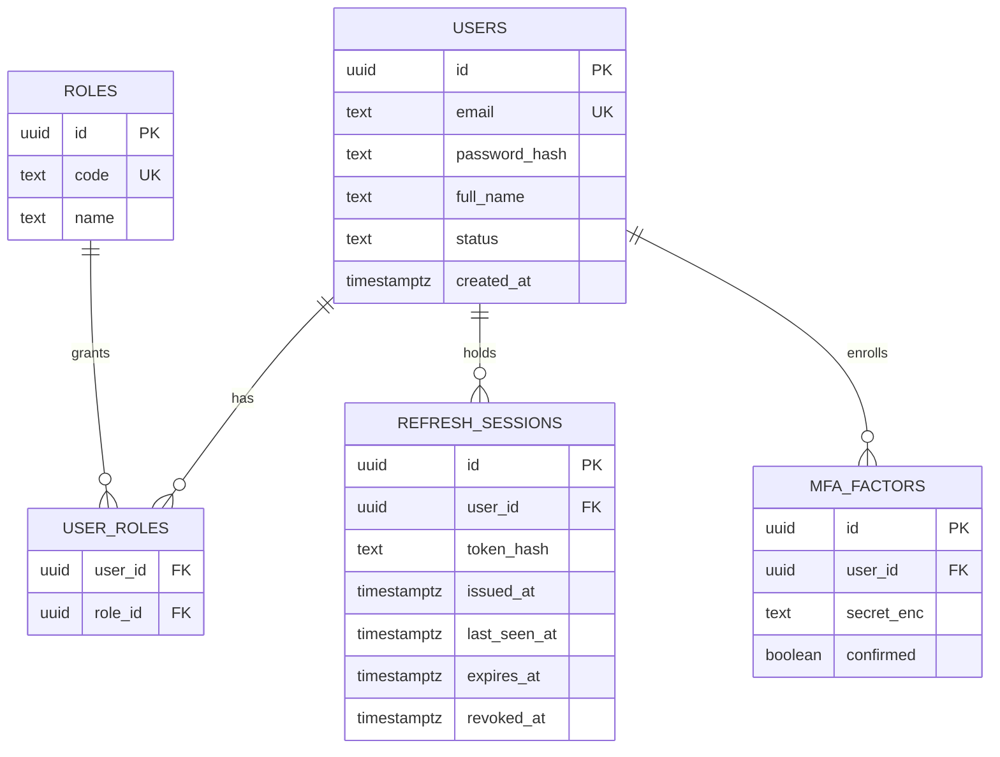
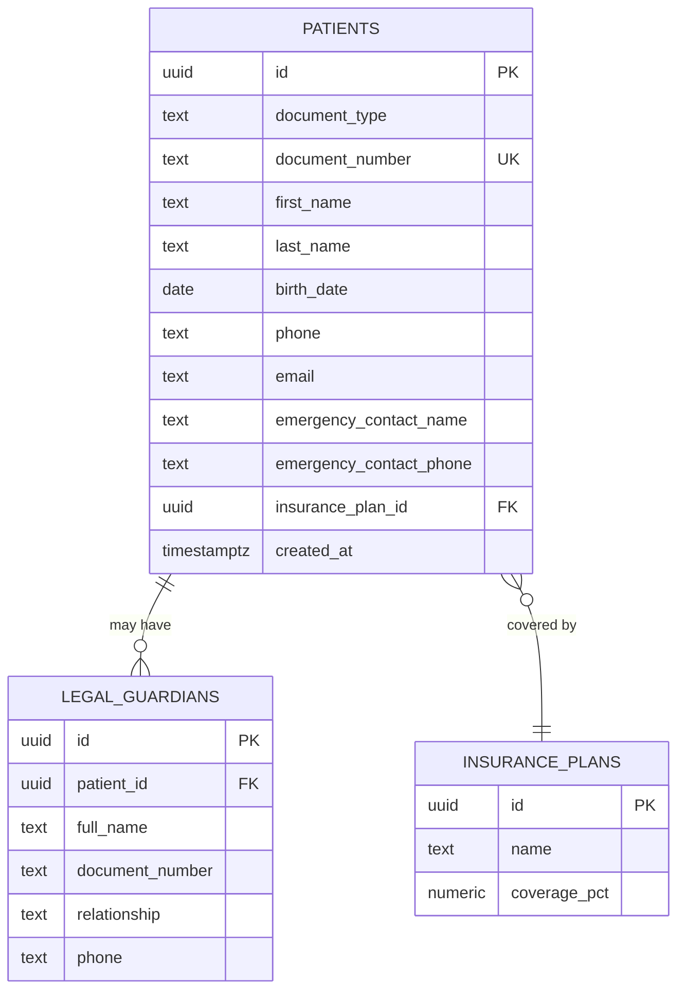
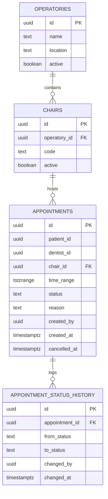
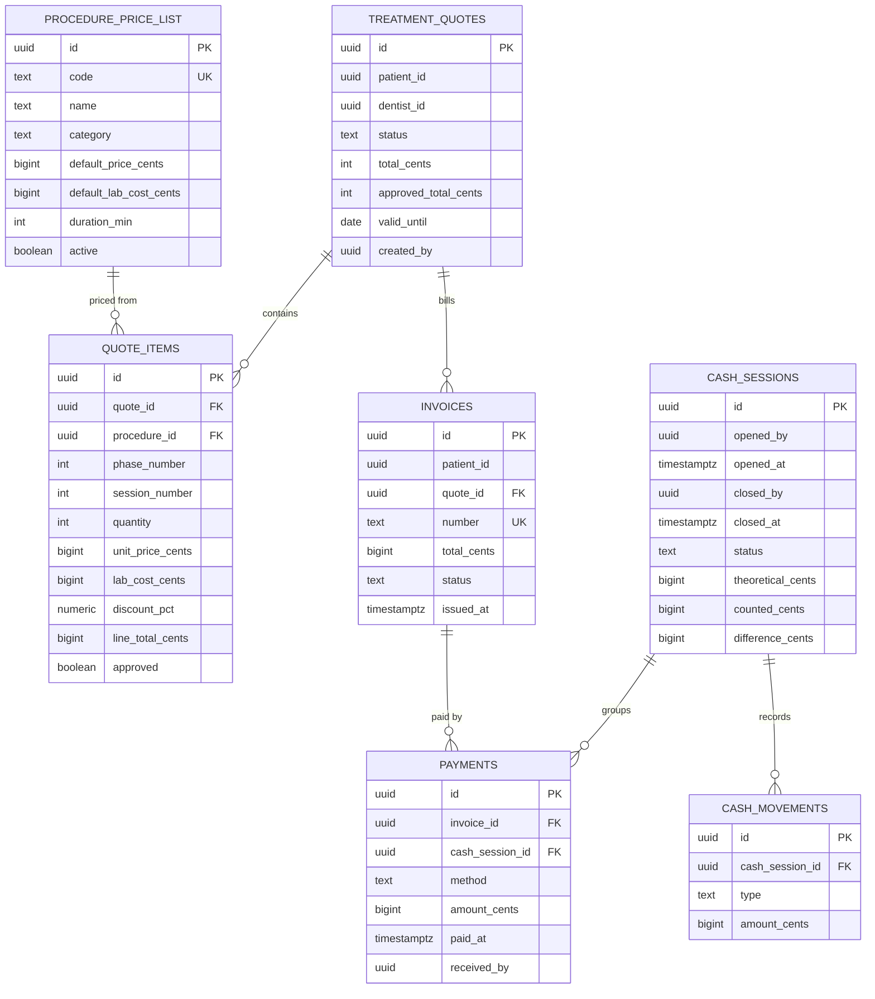
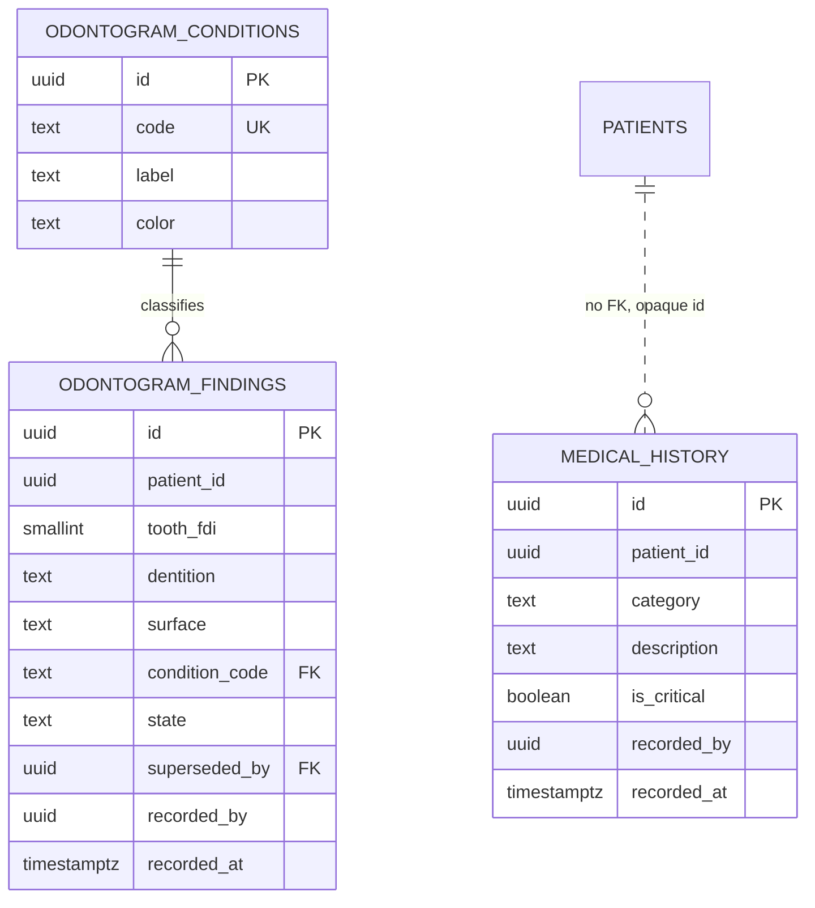

# Fase 1 — Data model, modules, and backlog

> Scope: SRS 8.1 Fase 1 — "Core Administrativo y Turnos": patients, appointment scheduling,
> medical catalog, and basic billing.
>
> Design document, not implementation. It proposes; `REQUIREMENTS_CHECKLIST.md` tracks progress.
> Every backlog task is ≤4 h (half a day) and names the checklist item it feeds.

## 1. Scope

### In Fase 1

| SRS | Requirement | Why it is here |
| --- | --- | --- |
| RF-01 | Unified patient record, legal guardian, insurance | Foundation for everything else |
| RF-02 | Medical history + critical alert badge | Blocks unsafe treatment; needed before quoting |
| RF-03 | Odontogram: state model, append-only findings, graphical capture | "Catalogo medico" includes it; RN-01 makes it expensive to retrofit |
| RF-07 | Multi-level quotes (phases, sessions, fees, lab cost, discounts) | Revenue starts here |
| RF-08 | Total/partial approval → agendable tasks | The only cross-domain flow in Fase 1 |
| RF-09 | Scheduling by operatory/chair and by professional | Core of the phase |
| RF-10 | Appointment state machine (7 states) | Drives the board and later billing |
| RF-12 | POS + mixed payments, **without SRI submission** | Billing basics; fiscal layer deferred |
| RN-02 | Blind cash close | Cash handling exists from day one |
| RN-03 | No chair double-booking | Concurrency invariant |
| RNF-05/06 | MFA, idle timeout, RBAC, immutable audit | Cannot be retrofitted cheaply |

### Out of Fase 1

| Item | Reason |
| --- | --- |
| RF-04, RF-05, RF-06 (periodontogram, SOEP, consent) | SRS Fase 2 |
| RF-11 notifications | Needs external provider credentials; not on the critical path |
| RF-13 fee settlement, RF-14 supply consumption | SRS Fase 3; RF-13 formula still undecided |
| SRI e-invoicing | Deferred by the owner |
| MinIO, DICOM, native mobile | Deferred / out of scope per SRS 2.3 |

> **SRS conflict resolved.** 8.1 lists "catalogo medico" in Fase 1 and "odontograma interactivo" in
> Fase 2. The owner's definition of catalogo medico includes the odontogram, so Fase 1 absorbs it.
> Fase 2 keeps periodontogram, SOEP, prescriptions, and consent.

## 2. Modules

Six domain modules in Fase 1 within the monolith. `inventory` and `notification` are not built yet.

| Domain module | Responsibility | Use cases | Tables it owns |
| --- | --- | --- | --- |
| `identity` | Who the user is and what they may do | login, refresh, MFA enroll/verify, role assignment, deactivate user | `users`, `roles`, `user_roles`, `refresh_sessions`, `mfa_factors` |
| `patient` | Who the patient is | register, update, search, guardian, insurance | `patients`, `legal_guardians`, `insurance_plans` |
| `clinical` | What is medically recorded about the patient | record antecedents, derive critical alert, record odontogram findings (append-only), correct via addendum, serve the whole chart | `medical_history`, `odontogram_conditions`, `odontogram_findings` |
| `scheduling` | When and where a professional sees a patient | manage operatory/chair, open appointment, transition state, query availability, cancel | `operatories`, `chairs`, `appointments`, `appointment_status_history` |
| `billing` | What was quoted, approved, paid, and closed | manage price list, build quote, recompute totals, approve (full/partial), invoice, register payment, open/close cash session | `procedure_price_list`, `treatment_quotes`, `quote_items`, `invoices`, `payments`, `cash_sessions`, `cash_movements` |

All tables live in the single `sigo` database, public schema. The monolith owns `audit_log`.

Internal layering per domain module is fixed by `AGENTS.md`: `entity` → `service` → `repository`
interface → `handler`. Nothing here changes that.

## 3. Data model

Money is `BIGINT` minor units (cents). All timestamps are `timestamptz` in UTC. Primary keys
are `UUID` generated by the owning service.

### 3.1 identity

Role codes: `system_admin`, `receptionist`, `cashier`, `dentist`, `dental_assistant`, `auditor`.
`receptionist` and `cashier` may be the same person; they stay separate because RN-02 is a
cashier-scoped restriction.

`refresh_sessions.last_seen_at` is what implements RNF-05's 15-minute idle timeout. A short access
token alone is not an idle timeout.

### 3.2 patient

Clinical data does not live here. Conditions and allergies belong to `clinical`, because they are
part of the record, not of identity. This service holds filiation only.

There is no `has_critical_alert` column. The SRS puts the badge in the header of the record
(RF-02), and `clinical` computes it when it serves the chart. An earlier draft stored it to show
the badge in list views, but the SRS never asks for that; the stored flag was scope I invented.

`document_number` is unique per `document_type`. Minors require at least one `legal_guardian`;
enforced in the service, not by a database constraint, because the rule is conditional on age.

### 3.3 scheduling

**RN-03 is a database constraint, not a service check:** an exclusion constraint over
`(chair_id WITH =, time_range WITH &&)` using `btree_gist`, with a partial predicate that
excludes `cancelled` and `no_show`. Two concurrent inserts must not both succeed; a concurrency
test proves it.

`time_range` is a single `tstzrange` column rather than `starts_at`/`ends_at`. This is deliberate:
the exclusion constraint needs a range, and one column cannot drift out of sync with itself.

`patient_id` and `dentist_id` carry no foreign key — they point at rows owned by `patient` and
`identity`. Cross-service referential integrity is a contract, not a constraint.

`operatory_id` is **not** stored on the appointment; it is derived through `chair_id`. A chair
cannot be moved between operatories without invalidating historical appointments otherwise.

### 3.4 billing

Quote status: `draft`, `sent`, `approved`, `partially_approved`, `rejected`, `expired`.
Payment method: `cash`, `card_credit`, `card_debit`, `transfer`, `insurance`.

**Mixed payment is not a table.** A `PaymentSplit` is simply N `payments` rows against one
invoice. A `payment_splits` table would duplicate `payments` with no extra attribute.

**Phases are not a table.** `phase_number` and `session_number` are ordinals on the item. A
`quote_phases` table would exist only to hold a number.

**RN-02 lives in `cash_sessions`.** `theoretical_cents` is stored but never serialized to a
`receptionist` or `cashier` while `status = open`. The API omits the field; a test asserts the
key is absent from the JSON, not that the UI hides it. `difference_cents` is computed only at
close.

### 3.5 clinical

`medical_history.category`: `systemic`, `allergy`, `surgical`, `coagulopathy` — the four the SRS names.

**The table is append-only and the trigger enforces it.** No `UPDATE`, no `DELETE`. A correction is a
new row whose `superseded_by` points at the row it replaces. RN-01 says nothing recorded as
`performed` may be deleted; enforcing it here costs one trigger and cannot be retrofitted once CRUD
endpoints exist.

`surface`: `mesial`, `distal`, `occlusal_incisal`, `vestibular`, `lingual_palatal`, or `null`.
`null` is required: an extraction, an implant, or an endodontic treatment affects the whole tooth.
Forcing a surface makes the dentist invent data.

**Only FDI is stored.** `tooth_fdi` covers permanent (11-48) and deciduous (51-85). Universal is a
derivation of 52 lookups at the edge. Storing a `notation` column would keep two representations of
the same tooth and guarantee they diverge.

`odontogram_conditions` holds the colors the SRS mandates (caries red, restorations blue). The
frontend reads them; it never hardcodes a palette.

### 3.6 Cross-domain rules

- Foreign keys are enforced across domain boundaries where the relationship is structural
  (e.g., `appointments.chair_id` FK to `chairs.id`). `patient_id` and `dentist_id` are
  foreign keys to their respective tables within the same database.
- A domain module may read another module's tables for cross-domain queries (e.g., scheduling
  queries patient details). The service layer owns the transaction boundary for atomic cross-domain
  operations.
- `audit_log` is insert-only. A trigger rejects `UPDATE` and `DELETE`.

### 3.7 Decisions worth defending

| # | Decision | Alternative rejected | Why |
| --- | --- | --- | --- |
| D1 | Mixed payments as N `payments` rows | `payment_splits` table | The split has no attributes of its own |
| D2 | Critical alert derived by `clinical` at read time | Stored `has_critical_alert` flag | RF-02 puts the badge in the record header only. A stored flag is a second source of truth for a value that one query already answers |
| D3 | `tstzrange` column + exclusion constraint | `starts_at`/`ends_at` + app validation | App validation loses the race; RN-03 is concurrency |
| D4 | Derive operatory from chair | Denormalize `operatory_id` on the appointment | Moving a chair would silently corrupt history |
| D5 | `theoretical_cents` stored, never serialized before close | Omit the column | The value is needed to compute the difference at close |
| D6 | Frontend joins staff names from `identity` | `staff` projection inside `scheduling` | Cross-domain foreign keys are enforced in the monolith; direct JOINs are safe and simpler |
| D7 | Declarative SVG, one `<path>` per surface | HTML Canvas | 160 paths is nothing for the DOM; Canvas needs manual hit-testing, `devicePixelRatio` scaling, and a repaint loop for zero gain |
| D8 | Surface label derived from tooth type and arch | Store "oclusal" / "lingual" as labels | A central incisor has an incisal edge, not an oclusal surface; a maxillary tooth is palatal, not lingual. The code stays `occlusal_incisal`, the label is computed |
| D9 | Tap the tooth, then pick the surface | Tap the surface directly | On a 10.5" tablet, one surface of a 32-tooth chart is ~15 px; a finger needs ~44 px. Direct surface tap is unusable at the chair |
| D10 | `odontogram_findings` is append-only | Soft-delete column | RN-01 forbids deleting a performed procedure; an addendum chain is the only model that survives an audit |

## 4. Cross-domain flows (Fase 1)

All flows are synchronous function calls within the monolith, wrapped in transactions when
atomicity is required.

| Flow | Caller | Callee | Effect |
| --- | --- | --- | --- |
| User deactivation | `identity.service.DeactivateUser` | Sets `users.status = inactive` | Login rejects inactive users |
| Quote approval → agendable tasks | `billing.service.ApproveQuote` | `scheduling.service.CreateAgendableTasks` | Creates agendable tasks for approved items in the same transaction |
| Audit logging | Every domain service on write | `audit_log` table | Writes audit row in the same transaction as the domain change |

## 5. Backlog — half-day tasks

Each task is ≤4 h. `Feeds` names the `REQUIREMENTS_CHECKLIST.md` item it completes.

### 5.1 Bootstrap (3.5 days)

| ID | Task | Done when | h | Feeds |
| --- | --- | --- | --- | --- |
| F1-01 | Create `backend/`, `internal/`, `migrations/`, `deploy/`, `go.work` | `go work use` lists platform + cmd/api | 4 | F0-B1, F0-B2 |
| F1-02 | `platform`: env config + `slog` logger | Bad env fails fast with a readable error | 3 | F0-B4 |
| F1-03 | `platform`: error envelope types + domain-error→HTTP mapping | Table test maps 6 domain errors to status + code | 4 | F0-B4 |
| F1-04 | `deploy/docker-compose.yml`: PostgreSQL 16 + Redis + healthchecks | `docker compose up` is healthy with no app | 3 | F0-B3 |
| F1-05 | Migration runner + `schema_migrations` (single directory) | Two migrations apply in order; re-run is a no-op | 4 | F0-B5 |
| F1-07 | CI: vet, test -race, lint, frontend typecheck | Pipeline red on a deliberate lint error | 3 | F0-B8 |
| F1-08 | `.gitignore` + `.env.example` | `git status` clean after a local run | 2 | F0-B9 |
| F1-09 | Frontend scaffold: Vite, TS, Tailwind, router, Query provider | `npm run dev` serves an empty shell | 4 | F0-F1 |
| F1-10 | Frontend `shared/lib/http.ts` + `ApiError` | Unit test covers 401 and network failure | 4 | F0-F1 |

### 5.2 Identity (3.5 days)

| ID | Task | Done when | h | Feeds |
| --- | --- | --- | --- | --- |
| F1-14 | Schema: users, roles, user_roles + seed of the 6 roles | Migration applies; roles queryable | 3 | F1-B01 |
| F1-15 | Password hashing with bcrypt on create and change | Hash never leaves the module; cost verified | 3 | F1-B01 |
| F1-16 | Login use case + JWT issue (HS256, 2 h, claims `sub`/`role`) | Test asserts claims and expiry | 4 | F1-B02 |
| F1-17 | Auth middleware in `platform` (validate locally) | Other modules validate without network | 4 | F1-B03 |
| F1-18 | Refresh sessions + 15-min idle timeout on `last_seen_at` | Idle test: 16 min → refresh rejected | 4 | F1-B04 |
| F1-19 | TOTP MFA enroll + verify for clinical/financial roles | Login without MFA blocked for `dentist` | 4 | F1-B05 |
| F1-20 | Role guards + `/health` | 403 on wrong role; health reports Postgres and Redis | 4 | F1-B06 |

### 5.3 Patient (3 days)

| ID | Task | Done when | h | Feeds |
| --- | --- | --- | --- | --- |
| F1-21 | Schema: patients, legal_guardians, insurance_plans | Migration applies; uniqueness on document | 4 | F1-B07 |
| F1-22 | Patient create/update service + validation | Minor without guardian rejected | 4 | F1-B07 |
| F1-23 | Patient read: by id, search by name/document, pagination | 10k-row fixture returns page in one query | 4 | F1-B07 |
| F1-24 | HTTP handlers + OpenAPI for patient endpoints | Spec generated and matches responses | 4 | F1-B07 |
| F1-27 | Audit on every patient write (direct table insert) | Each CRUD inserts one `audit_log` row | 4 | F1-B10 |
| F1-28 | `/health` | Reports Postgres up/down | 2 | F1-B11 |

### 5.4 Scheduling (4.5 days)

| ID | Task | Done when | h | Feeds |
| --- | --- | --- | --- | --- |
| F1-29 | Schema: operatories, chairs + CRUD | CRUD covered; inactive chair hidden from availability | 4 | F1-B12 |
| F1-30 | Schema: appointments with `tstzrange` + status enum | Constraint present in the migration | 4 | F1-B13 |
| F1-31 | **RN-03 exclusion constraint + concurrency test** | Two parallel inserts: exactly one succeeds | 4 | F1-B14 |
| F1-32 | Create/update appointment service + overlap pre-check | 409 with `chair_overlap` before hitting the constraint | 4 | F1-B13 |
| F1-33 | Status machine with legal transitions only | Illegal transition rejected with a stable code | 4 | F1-B13 |
| F1-34 | Status history rows on every transition | History matches the transitions in a test | 3 | F1-B13 |
| F1-35 | Availability query by chair and by dentist | Range query returns correct free slots | 4 | F1-B15 |
| F1-36 | Cache-Aside for availability + Redis degradation | Redis down: same response, higher latency | 3 | F1-B16 |
| F1-37 | Handlers + OpenAPI | Spec matches responses | 4 | F1-B15 |
| F1-38 | `/health` | Reports Postgres and Redis | 2 | F1-B17 |

### 5.5 Billing (5.5 days)

| ID | Task | Done when | h | Feeds |
| --- | --- | --- | --- | --- |
| F1-39 | Schema + CRUD for `procedure_price_list` | Catalog queryable by category | 4 | F1-B18 |
| F1-40 | Schema: quotes + quote_items (phases, sessions) | Migration applies | 4 | F1-B18 |
| F1-41 | Quote create/update with server-side total recompute | Client-supplied total is ignored (test) | 4 | F1-B19 |
| F1-42 | Discount and lab-cost rules + tests | Money math covered by pure-function tests | 4 | F1-B18 |
| F1-43 | Full and partial approval, persisting approved item ids | Partial approval stores exactly the selected ids | 4 | F1-B20 |
| F1-44 | Approval calls `scheduling.CreateAgendableTasks` synchronously | Agendable tasks created in the same transaction | 4 | F1-B21 |

| F1-46 | Invoice issue + number sequence | Concurrent issue never duplicates a number | 4 | F1-B22 |
| F1-47 | Payment registration (mixed via N rows) | Three payments on one invoice reconcile | 4 | F1-B22 |
| F1-48 | Cash session open/close + `FOR UPDATE` | Concurrent close does not double-count | 4 | F1-B23 |
| F1-49 | **RN-02: omit `theoretical_cents` before close** | Test asserts the key is absent from JSON | 3 | F1-B23 |
| F1-50 | Handlers + OpenAPI | Spec matches responses | 4 | F1-B24 |
| F1-51 | `/health` | Reports Postgres and Redis | 2 | F1-B24 |

### 5.6 Clinical (6 days)

| ID | Task | Done when | h | Feeds |
| --- | --- | --- | --- | --- |
| F1-25 | Schema `medical_history` with the 4 SRS categories | Migration applies; 4 categories queryable | 3 | F1-B08 |
| F1-26 | Critical-alert derivation at read time | Adding a critical allergy makes the badge appear | 3 | F1-B09 |
| F1-68 | `odontogram_conditions` catalog + seed with the SRS colors | Legend renders from data | 3 | F1-B08 |
| F1-69 | `odontogram_findings` schema + append-only trigger | `UPDATE` and `DELETE` rejected by the database | 4 | RN-01 |
| F1-70 | FDI/Universal mapping as pure functions | All 52 codes round-trip | 3 | RF-03 |
| F1-71 | Record-finding validation: tooth exists in dentition, surface valid for tooth type | Recording oclusal on tooth 21 is rejected | 4 | RF-03 |
| F1-72 | Addendum flow through `superseded_by` | Correction keeps the original row and links to it | 3 | RN-01 |
| F1-73 | Read the whole chart in one query | 32 teeth plus findings in a single response | 3 | RNF-01 |
| F1-74 | Handlers + OpenAPI | Spec matches responses | 4 | RF-03 |
| F1-75 | SVG tooth component: 8 archetypes, 5 paths each, via `<symbol>`/`<use>` | No duplicated path data across 32 teeth | 4 | RF-03 |
| F1-76 | Quadrant layout; permanent, deciduous, and mixed dentition | A 7-year-old renders both dentitions | 4 | RF-03 |
| F1-77 | Surface selection with tablet-sized targets | Every surface reachable at 10.5" without zoom | 4 | RNF-07 |
| F1-78 | Colors and legend read from `odontogram_conditions` | Changing a catalog color changes the chart | 3 | RF-03 |
| F1-79 | Append-only UX: no delete, "add addendum" only | No delete control exists for a performed finding | 3 | RN-01 |
| F1-80 | `/health` | Reports Postgres | 2 | F1-B11 |

### 5.7 Frontend (6 days)

| ID | Task | Done when | h | Feeds |
| --- | --- | --- | --- | --- |
| F1-52 | Generated API types + regeneration script | `npm run gen:api` overwrites `shared/types/api.ts` from monolith OpenAPI | 4 | F1-F02 |
| F1-53 | Login, token storage, role guards, silent refresh | Expired token refreshes without a visible reload | 4 | F1-F01 |
| F1-54 | Patient list with search and pagination | 10k patients scroll without jank | 4 | F1-F03 |
| F1-55 | Patient detail + create/edit form with Zod | Invalid document blocked client-side and server-side | 4 | F1-F03 |
| F1-56 | Critical-alert badge in header and list rows | Driven by the API flag, not by client logic | 3 | F1-F04 |
| F1-57 | Calendar day/week filtered by chair and by dentist | Filter changes without refetching the whole day | 4 | F1-F05 |
| F1-58 | Appointment board with legal transitions only | Illegal button is absent, not disabled | 4 | F1-F06 |
| F1-59 | Quote builder with phases and sessions | Total matches server value after save | 4 | F1-F07 |
| F1-60 | Partial approval screen | Selecting 2 of 5 items persists exactly 2 | 4 | F1-F07 |
| F1-61 | Payment capture with mixed methods | Split sums to invoice total | 4 | F1-F08 |
| F1-62 | Cash close screen without theoretical total | No network response contains the field | 4 | F1-F08 |
| F1-63 | Responsive audit at 1920/1366/tablet | No horizontal overflow on the five main screens | 4 | F1-F09 |

### 5.8 Hardening (1.5 days)

| ID | Task | Done when | h | Feeds |
| --- | --- | --- | --- | --- |
| F1-64 | Coverage ≥80% on patient, scheduling, billing critical endpoints | Report attached | 4 | F4-01 |
| F1-65 | Load test at 150 concurrent users | p95 within RNF-01 under the RNF-03 load | 4 | F4-03 |
| F1-66 | OWASP Top 10 pass on Fase 1 endpoints | No High/Critical finding | 4 | F4-02 |

## 6. Open decisions

| # | Decision | Blocks | Default if unresolved |
| --- | --- | --- | --- |
| O1 | Should a dentist also be prevented from double-booking across chairs? | F1-31 | Add the second exclusion constraint; SRS does not require it but a dentist cannot be in two chairs |
| O2 | Are `receptionist` and `cashier` the same person in this clinic? | F1-20, F1-49 | Keep both roles; RN-02 is cashier-scoped |
| O3 | Insurance coverage: percentage off the total, or per-procedure? | F1-41 | Percentage off the quote total |
| O4 | Does partial approval create appointments automatically or only tasks? | F1-45 | Tasks only; the receptionist schedules |
| O5 | Invoice numbering: per clinic, per year, or per cash session? | F1-46 | Per year with a zero-padded sequence |

## 7. Estimate

76 tasks totalling 271 h ≈ 33.9 working days ≈ 6.8 weeks for one developer, excluding review
and rework.

Against the SRS's "Sprints 1–4", that only fits if a sprint is two weeks. If a sprint is one
week, Fase 1 does not fit in four and something must leave the phase — the cheapest cut is
RF-12 payments and cash close, which would move to Fase 2 while quotes and scheduling stay.
